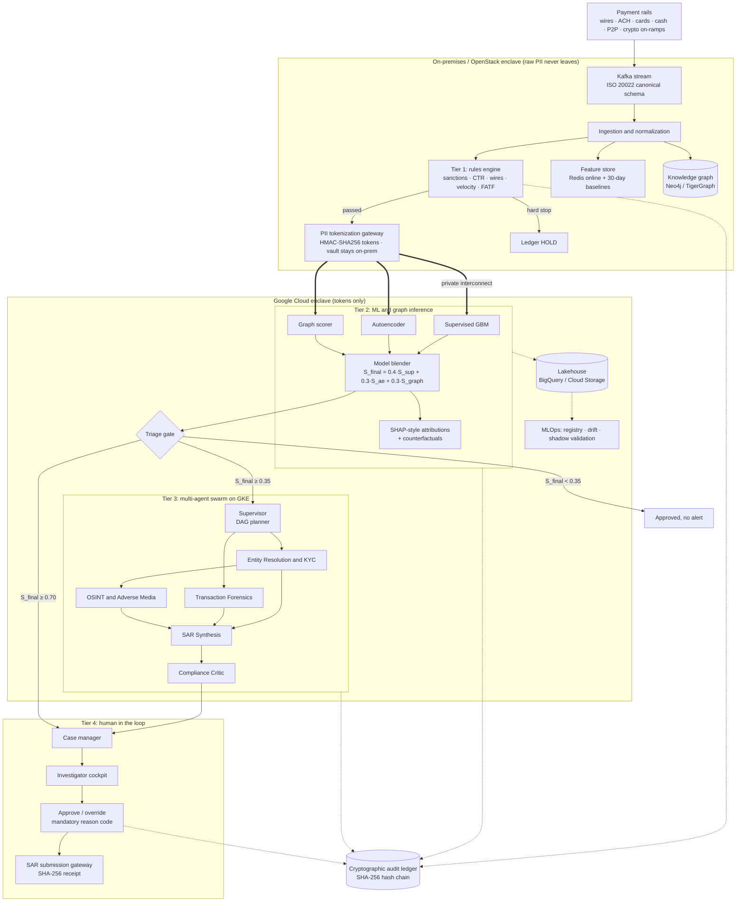
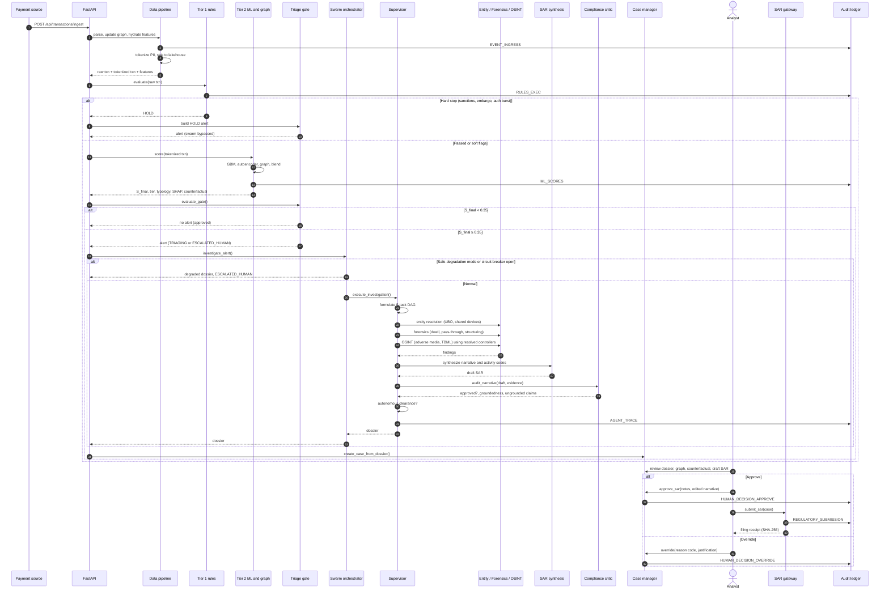
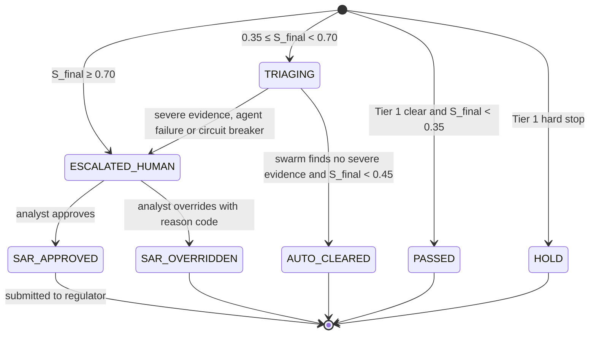
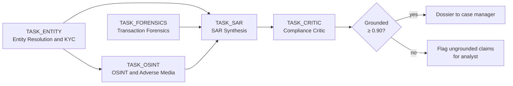

# Sentinel AML: diagrams (Mermaid)

Paste each block into https://mermaid.live (or any Mermaid viewer) and export PNG or SVG for Medium.

## 1. Architecture

## 2. End-to-end sequence

## 3. Case state machine

## 4. Agent task DAG

